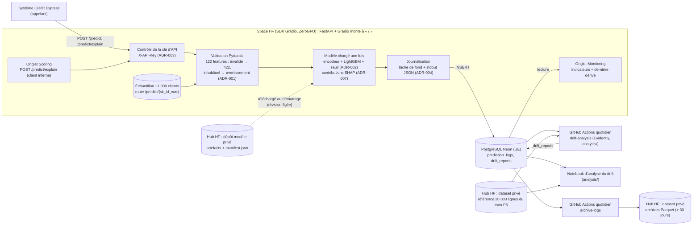
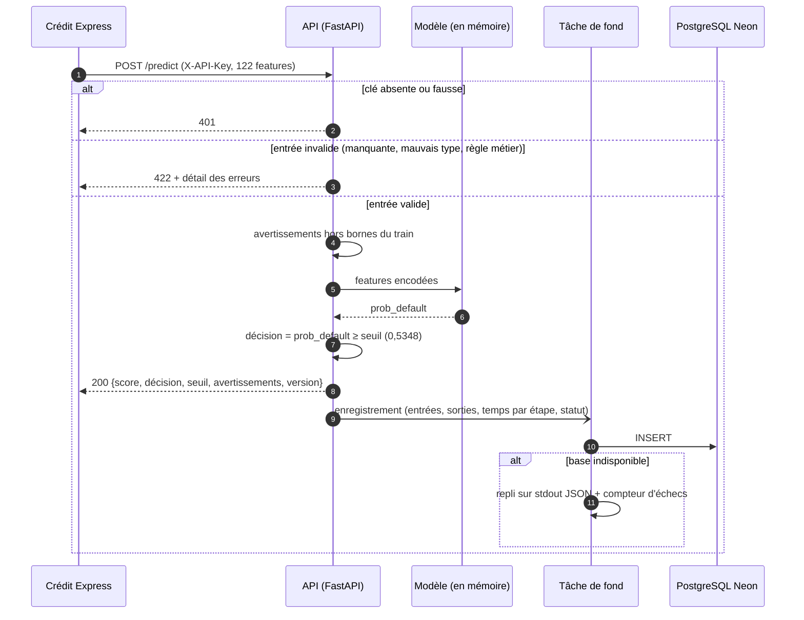
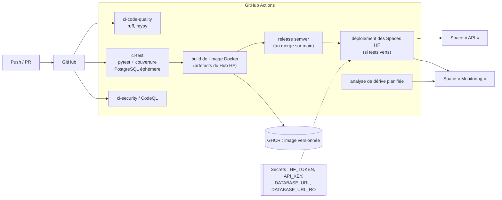

# Architecture — OC-AIE-P8

Décisions de référence : `docs/spec.md` (ADR-001 à ADR-007). Schéma mis à jour au lot
v0.4.0 : le dashboard est un onglet du Space de l'API (révisions de l'ADR-005), et non un
second Space Streamlit comme prévu aux specs.

## Composants

## Séquence du flux principal

## Déploiement

