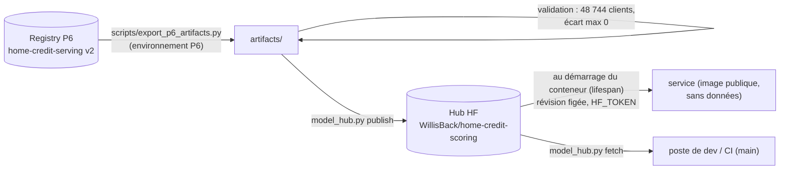

# Artefacts du modèle

Décision de référence : ADR-002 (`docs/spec.md`). MLflow reste la source de vérité de la
traçabilité (Registry de P6) ; le service n'en dépend pas au runtime.

## Contenu

| Fichier | Rôle |
|---|---|
| `model.txt` | booster LightGBM `home-credit-lightgbm` v9 (tuned), format texte natif (pas de pickle) |
| `features.json` | ordre d'entrée des 122 features, catégories de l'encodeur ordinal, ordre des colonnes vu par le modèle, bornes min/max du jeu d'entraînement |
| `sample_clients.csv` | 1 000 clients du jeu de test (tirage figé, graine 42) : route de démo et jeu de non-régression |
| `reference_predictions.csv` | scores et décisions calculés par le modèle P6 sur ces 1 000 clients |
| `manifest.json` | version du Registry, run MLflow, seuil métier, coûts FN/FP, version de LightGBM, empreintes SHA-256, résultat de la validation |

## Cycle de vie

1. **Export** (une fois par nouvelle version du modèle) : le script lit le Registry de P6,
   écrit les artefacts, puis recharge le modèle avec `credit_scoring.model` et compare ses
   scores à ceux de P6 sur tout le jeu de test. Résultat de l'export du 22/11/2026 :
   **écart maximal 0,0 sur 48 744 clients, décisions identiques**.
2. **Publication** sur un dépôt modèle **privé** du Hub (l'échantillon provient des données
   Kaggle, non redistribuables ; accès par `HF_TOKEN`) ; le SHA du commit est écrit dans
   `model_revision.txt`, versionné avec le code.
3. **Téléchargement** à cette révision exacte, jamais `main` : un même commit du code
   sert toujours les mêmes octets du modèle. Le chargement refuse tout fichier absent ou
   dont l'empreinte diffère du manifeste. Dans l'image Docker, c'est le `lifespan` qui
   télécharge (`credit_scoring.hub.ensure_artifacts`) au premier démarrage : l'image GHCR
   est publique et ne contient que le code et `model_revision.txt`.

## Garanties

- **Même modèle que P6** : `tests/test_non_regression.py` (tolérance 1e-9, décisions
  identiques) — marqué `integration` car il lit les artefacts réels.
- **Chargé une seule fois par processus** : `credit_scoring.model.get_model` (cache
  `lru_cache`), appelé au démarrage de l'API (lot v0.1.0, #12).
- **Rien de lourd dans Git** : `artifacts/` est ignoré ; seul `model_revision.txt` (40
  caractères) est versionné.
