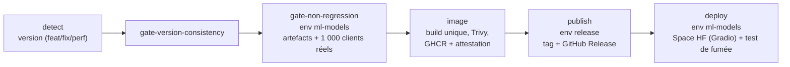

# CI/CD

## Sur chaque PR (`ci-*.yml`)

Qualité (ruff, mypy, actionlint, zizmor), tests unitaires sur le modèle synthétique
(couverture lignes et branches ≥ 80 %, rapport dans le résumé du job), sécurité
(Gitleaks, SCA, Trivy du dépôt), CodeQL, traçabilité, build de l'image et test de fumée.
Aucun secret : les PR ne voient ni le modèle réel ni le Space.

## Sur `main` (`release.yml`)

Un échec arrête la chaîne : pas d'image si la non-régression échoue, pas de déploiement
sans image scannée et taguée. Le SDK Docker des Spaces étant payant, le Space est en SDK
**Gradio** (#29) : `scripts/deploy_space.py` y pousse un `app.py` qui lance l'API FastAPI
(uvicorn, port 7860), un `requirements.txt` aux versions exactes de `uv.lock` qui installe
le paquet **depuis le tag**, `packages.txt` (libgomp1) et `model_revision.txt`. Le Space est
sur le matériel **ZeroGPU** (gratuit, réservé au SDK Gradio), qui arrête toute application
qui ne s'annonce pas au démarrage : `app.py` importe `spaces`, déclare une fonction
`@spaces.GPU` (jamais appelée : le scoring LightGBM reste sur CPU, sans quota consommé) et
sert l'API derrière `ZeroGPUMiddleware`, qui envoie le « startup report » (#38). Le
déploiement n'est validé que si l'URL publique annonce la nouvelle version (`/health`) et
répond à une prédiction authentifiée. L'image GHCR reste publiée pour un hébergeur Docker.

## Secrets

| Secret | Où | Sert à |
|---|---|---|
| `HF_TOKEN` | environnement `ml-models` (main) | lire le dépôt modèle privé (gate), écrire le Space (deploy) |
| `SPACE_HF_TOKEN` | environnement `ml-models` → secret du Space `HF_TOKEN` | lecture seule du dépôt modèle, au démarrage du conteneur |
| `API_KEY` | environnement `ml-models` → secret du Space | clé attendue dans `X-API-Key` |
| `RELEASE_TOKEN` | environnement `release` (main) | créer le tag malgré la modification des workflows |

Le Space reçoit un jeton **en lecture seule** : un conteneur compromis ne peut ni modifier
le modèle ni redéployer le Space.
