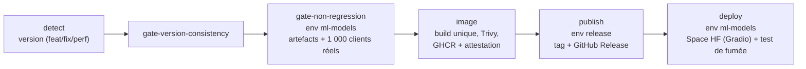

# CI/CD

## Sur chaque PR (`ci-*.yml`)

Qualité (ruff, mypy, actionlint, zizmor), tests unitaires sur le modèle synthétique
(couverture lignes et branches ≥ 80 %, rapport dans le résumé du job ; tests de stockage
aussi sur un **Postgres 17 éphémère**, service du job ; module de dérive testé à part dans
le sous-projet `analysis/`, job `ci-test (dérive, analysis/)` filtré sur `monitoring/`,
`model.py`, `analysis/`, `tests/drift/`, les scripts et fixtures dont il dépend, `pyproject.toml`
et le workflow, couverture 100 % ; après tout changement de dépendance racine, régénérer
aussi `uv lock --project analysis`), sécurité
(Gitleaks, SCA, Trivy du dépôt), CodeQL, traçabilité, build de l'image et test de fumée.
Aucun secret : les PR ne voient ni le modèle réel ni le Space.

## Sur `main` (`release.yml`)

La gate exécute aussi un test d'écriture sur Neon, dans un schéma temporaire supprimé après
coup. Le job `deploy` applique les migrations de la base (`python -m
credit_scoring.monitoring.db`) avant de pousser le nouveau code, puis transmet
`DATABASE_URL` au Space ; son test de fumée est marqué `X-Client: ci`.

Un échec arrête la chaîne : pas d'image si la non-régression échoue, pas de déploiement
sans image scannée et taguée. Le SDK Docker des Spaces étant payant, le Space est en SDK
**Gradio** (#29) : `scripts/deploy_space.py` y pousse un `app.py` qui lance l'API FastAPI
(uvicorn, port 7860), un `requirements.txt` aux versions exactes de `uv.lock` qui installe
le paquet **depuis le tag**, `packages.txt` (libgomp1) et `model_revision.txt`. Le Space est
sur le matériel **ZeroGPU** (gratuit, réservé au SDK Gradio), qui arrête toute application
qui ne s'annonce pas au démarrage : `app.py` importe `spaces` en premier et déclare une
fonction `@spaces.GPU` (jamais appelée : le scoring LightGBM reste sur CPU, sans quota
consommé). `spaces` remplace `gr.mount_gradio_app` : le montage de l'interface à « / »
(#40) ajoute alors `ZeroGPUMiddleware`, qui envoie le « startup report » (#38). Le
`requirements.txt` inclut l'extra `ui` (Gradio) ; uvicorn tourne sans logs d'accès, qui
montreraient l'identifiant réel des routes de démo. Le
déploiement n'est validé que si l'URL publique annonce la nouvelle version (`/health`) et
répond à une prédiction authentifiée. L'image GHCR reste publiée pour un hébergeur Docker.

## Secrets

| Secret | Où | Sert à |
|---|---|---|
| `HF_TOKEN` | environnement `ml-models` (main) | lire le dépôt modèle privé (gate), écrire le Space (deploy) |
| `SPACE_HF_TOKEN` | environnement `ml-models` → secret du Space `HF_TOKEN` | lecture seule du dépôt modèle, au démarrage du conteneur |
| `API_KEY` | environnement `ml-models` → secret du Space | clé attendue dans `X-API-Key` |
| `DATABASE_URL` | environnement `ml-models` → secret du Space | base Neon des journaux de production (gate, migrations, Space, archivage, analyse de dérive) |
| `RELEASE_TOKEN` | environnement `release` (main) | créer le tag malgré la modification des workflows |

Le Space reçoit un jeton **en lecture seule** : un conteneur compromis ne peut ni modifier
le modèle ni redéployer le Space.

## Planifié (`archive-logs.yml`)

Chaque jour à 03:00 UTC (et à la main, avec une durée courte pour la démo) : archivage des
journaux de plus de 30 jours dans un dataset Hugging Face privé, puis purge dans Neon
(`docs/monitoring.md`). Environnement `ml-models` (`DATABASE_URL`, `HF_TOKEN`).

## Planifié (`drift-analysis.yml`)

Le job tourne chaque jour à 04:00 UTC, et à la main avec une fenêtre au choix. Il analyse
la dérive des 7 derniers jours de trafic de production par rapport à la référence (dataset
HF privé), dans le sous-projet `analysis/`.

- Il écrit une ligne dans `drift_reports`, que lit l'onglet Monitoring.
- Il publie le rapport Evidently HTML comme artefact `drift-report`, gardé 30 jours.
- Environnement `ml-models` : `DATABASE_URL`, et `HF_TOKEN` pour lire le modèle et la
  référence.
