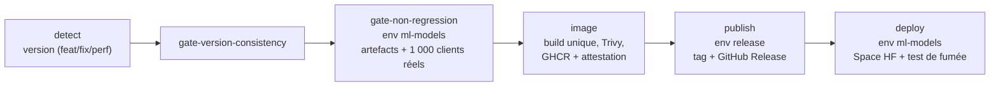

# CI/CD

## Sur chaque PR (`ci-*.yml`)

Qualité (ruff, mypy, actionlint, zizmor), tests unitaires sur le modèle synthétique
(couverture lignes et branches ≥ 80 %, rapport dans le résumé du job), sécurité
(Gitleaks, SCA, Trivy du dépôt), CodeQL, traçabilité, build de l'image et test de fumée.
Aucun secret : les PR ne voient ni le modèle réel ni le Space.

## Sur `main` (`release.yml`)

Un échec arrête la chaîne : pas d'image si la non-régression échoue, pas de déploiement
sans image scannée et taguée. Le Space exécute l'image **épinglée par digest**
(`FROM ghcr.io/…@sha256:…`) : exactement les octets scannés et attestés, rien n'est
reconstruit. Le déploiement n'est validé que si l'URL publique annonce la nouvelle version
(`/health`) et répond à une prédiction authentifiée.

## Secrets

| Secret | Où | Sert à |
|---|---|---|
| `HF_TOKEN` | environnement `ml-models` (main) | lire le dépôt modèle privé (gate), écrire le Space (deploy) |
| `SPACE_HF_TOKEN` | environnement `ml-models` → secret du Space `HF_TOKEN` | lecture seule du dépôt modèle, au démarrage du conteneur |
| `API_KEY` | environnement `ml-models` → secret du Space | clé attendue dans `X-API-Key` |
| `RELEASE_TOKEN` | environnement `release` (main) | créer le tag malgré la modification des workflows |

Le Space reçoit un jeton **en lecture seule** : un conteneur compromis ne peut ni modifier
le modèle ni redéployer le Space.
