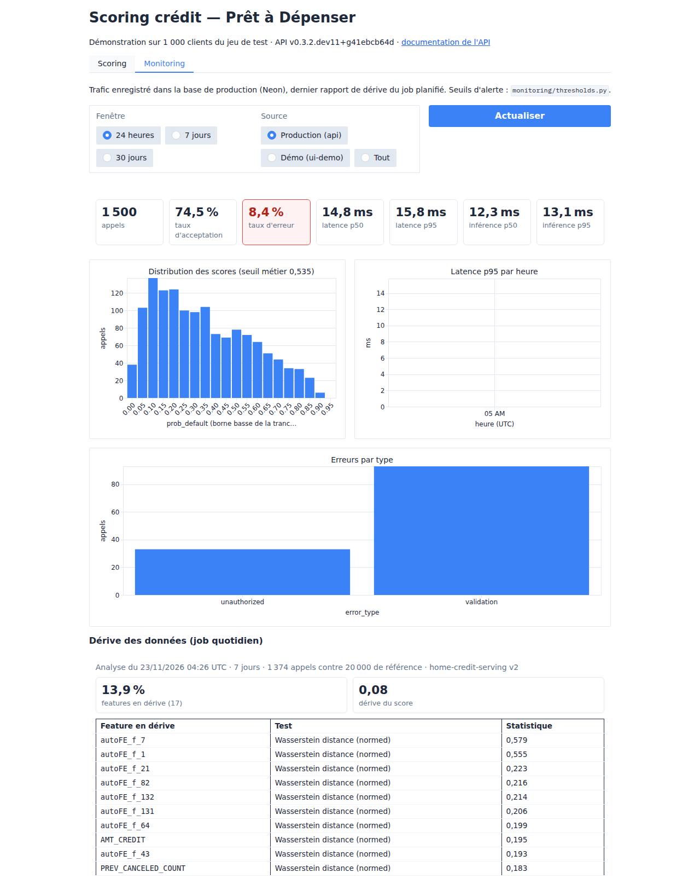

# Journalisation et stockage des données de production

Décisions : ADR-004 (stockage) et ADR-005 (dashboard) dans `docs/spec.md` ; design détaillé
dans `docs/superpowers/specs/2026-11-22-journalisation-production-design.md` (#16).

## Ce qui est stocké, et pourquoi

Chaque appel `POST /predict`, `POST /predict/explain` ou `POST /predict/{sk_id_curr}` produit
**un enregistrement**
(table `prediction_logs`), y compris les appels refusés. Choix de William : tout tracer,
chaque groupe de colonnes servant un usage du monitoring.

| Groupe | Colonnes | Usage |
|---|---|---|
| Traçabilité | `request_id` (aussi renvoyé en en-tête `X-Request-ID`), `created_at` (UTC), `source`, `path` (gabarit de route), `api_version`, `model_version` | relier une ligne à une version du code et du modèle ; isoler la démo et la CI |
| Identité | `client_ref` : HMAC-SHA256 de `SK_ID_CURR` (route de démo seulement) | suivre les appels d'un même client **sans** l'identifier |
| Entrées | `features` : les 122 features validées ; pour un 422, le corps reçu (tronqué à 64 Kio) ; rien pour un 401 | dérive des données (Evidently, v0.4.0) |
| Sorties | `prob_default`, `decision`, `threshold`, `warnings`, `n_warnings` | dérive des scores, taux de refus, valeurs hors bornes |
| Performance | `latency_ms` (requête complète), `inference_ms` (encodage et `model.predict` ; plus les contributions SHAP sur `/predict/explain`) | latence, latences anormales, comparaison avant/après optimisation |
| Erreurs | `status_code`, `error_type` (`unauthorized`, `not_found`, `validation`, `client_error`, `internal`), `error_detail` (détail compact du 422) | taux d'erreur, champs le plus souvent refusés |

`source` vaut `api` (trafic de production, y compris la simulation), `ui-demo` (interface
Gradio, en-tête `X-Client`) ou `ci` (test de fumée de chaque release). **Les analyses de
production filtrent `source = 'api'`** : les essais de démonstration ne faussent pas le drift.
L'en-tête n'est pas une authentification, seulement un tri.

## Comment c'est écrit

- Un middleware ASGI mesure et assemble l'enregistrement ; les routes y déposent features,
  score et temps d'inférence.
- **Deux sorties** : une ligne JSON sur stdout (logs du Space), et une écriture en base par un
  thread de fond, par lots.
- **Une panne de la base ne casse jamais une prédiction** : file pleine ou base injoignable →
  enregistrement abandonné et compté ; `GET /health` expose `logging.database` et
  `logging.dropped`. La ligne stdout reste.
- Stack : SQLAlchemy 2, psycopg 3, migrations Alembic appliquées par le job `deploy` de la
  release (jamais par l'application).

## Où : Neon, région UE

Postgres managé [Neon](https://neon.com), projet `credit-scoring-P8`, région
**aws-eu-central-1 (Francfort)** : les données restent dans l'UE. Offre gratuite : 1 Go de
stockage (≈ 250 000 appels), mise en veille après 5 minutes d'inactivité. Le disque d'un
Space gratuit étant effacé à chaque redémarrage (donc à chaque déploiement), une base SQLite
locale aurait perdu les données à chaque release.

## Rétention et archivage

- **Fenêtre glissante de 30 jours** pour les données vivantes (décision de William).
- **Archivage quotidien** (`archive-logs.yml`, 03:00 UTC) : les lignes de plus de 30 jours
  partent en Parquet dans un dataset Hugging Face **privé**
  (`WillisBack/credit-scoring-logs-archive`), puis sont supprimées de Neon — seulement après
  l'envoi réussi.
- Mécanisme **démonstratif** : le projet est soutenu avant que des données atteignent
  30 jours ; le workflow se lance à la main avec une durée courte (`older_than = 1h`). Les
  archives ne sont pas conservées : le dataset est supprimé à l'arrêt du Space.

## RGPD

| Principe | Mise en œuvre |
|---|---|
| Minimisation | pas de nom ni de contact (absents du jeu Kaggle) ; aucun corps stocké pour un appel non authentifié |
| Pseudonymisation | `SK_ID_CURR` jamais stocké en clair (HMAC dérivé de la clé d'API ; une rotation de la clé change les pseudonymes) ; `path` = gabarit de route, sans l'identifiant |
| Limitation de la conservation | 30 jours en base, archives supprimées avec le projet |
| Localisation | Neon en UE (Francfort), dataset d'archive privé |
| Sécurité | accès par secret (`DATABASE_URL`, environnement GitHub `ml-models` limité à `main`, secret du Space) ; chiffrement au repos assuré par Neon ; TLS obligatoire (`sslmode=require`) |
| Pistes non implémentées (oral) | chiffrement applicatif des colonnes sensibles ; rôles Postgres séparés (écriture seule pour l'API, lecture seule pour le dashboard) |

Les features restent des données personnelles (revenus, âge, genre) : elles sont gardées
parce que l'analyse du drift en a besoin, et seulement pendant la fenêtre de 30 jours.

## Simulation de trafic

```bash
API_KEY=… uv run python scripts/simulate_traffic.py --p6 <dossier P6> \
    --url https://willisback-credit-scoring-api.hf.space --n 2000 --rate 5
```

Clients tirés de `clients.db` de P6 (jeu de test Kaggle, local), envoyés tels quels : leur
écart au jeu d'entraînement est une vraie dérive. 5 % de requêtes violent une règle métier
(422) et 2 % n'ont pas de clé (401).

## Requêtes d'exemple (console SQL Neon)

```sql
-- Volume et taux d'erreur par source
SELECT source, count(*) AS appels,
       round(100.0 * avg((status_code >= 400)::int), 1) AS pct_erreurs
FROM prediction_logs GROUP BY source;

-- Latence p95 par heure (trafic de production)
SELECT date_trunc('hour', created_at) AS heure,
       percentile_cont(0.95) WITHIN GROUP (ORDER BY latency_ms) AS p95_ms,
       percentile_cont(0.95) WITHIN GROUP (ORDER BY inference_ms) AS p95_inference_ms
FROM prediction_logs WHERE source = 'api' AND status_code = 200 AND path <> '/predict/explain'
GROUP BY 1 ORDER BY 1;

-- Distribution des scores et taux de refus
SELECT width_bucket(prob_default, 0, 1, 10) AS tranche, count(*),
       round(100.0 * avg((decision = 'refusé')::int), 1) AS pct_refus
FROM prediction_logs WHERE source = 'api' AND status_code = 200
GROUP BY 1 ORDER BY 1;

-- Champs les plus souvent refusés (422)
SELECT e->'loc'->>-1 AS champ, count(*)
FROM prediction_logs, jsonb_array_elements(error_detail) AS e
WHERE error_type = 'validation' GROUP BY 1 ORDER BY 2 DESC;
```

## Analyse de la dérive (#17)

Décisions de William : ADR-005 et sa révision du 23/11/2026 (`docs/spec.md`).

- **Référence** : on tire 20 000 lignes du train de P6, stratifiées sur `TARGET` (graine 42).
  - Elles sont publiées en Parquet dans le dataset HF **privé**
    `WillIsback/credit-scoring-drift-reference`, via `scripts/export_drift_reference.py`.
  - Chaque ligne contient les 122 features au format de l'API, plus `prob_default`, le score
    du modèle servi. Ce score sert de référence pour la dérive des scores.
- **Production** : les appels réussis (`status_code = 200`) de `source = 'api'` sur la
  fenêtre, soit 7 jours par défaut.
- **Calcul** : le module `credit_scoring.monitoring.drift` utilise les tests par défaut
  d'Evidently 0.7.23, avec un seuil de 0,1.
  - Variables numériques : distance de Wasserstein normalisée.
  - Variables catégorielles, et numériques à peu de valeurs : distance de Jensen-Shannon.
  - Une colonne entièrement vide dans la fenêtre est écartée et marquée « vide ».
  - En dessous de 200 appels, le rapport dit « échantillon insuffisant » au lieu de
    calculer.
- **Où ça tourne** :
  - Le sous-projet `analysis/` a son propre verrou, en pandas 2.3, parce qu'Evidently ne
    s'importe pas avec pandas 3. L'API et le Space n'importent jamais Evidently.
  - Le job `drift-analysis` tourne chaque jour à 04:00 UTC. Il écrit une ligne dans
    `drift_reports` et publie le rapport HTML comme artefact du run.
  - Le notebook `notebooks/analyse_drift.ipynb` utilise le même module, donc le même calcul.
- **Seuils d'alerte** : ils sont dans `src/credit_scoring/monitoring/thresholds.py`. Les
  valeurs de départ ont été proposées par l'agent ; c'est à William de les fixer (part 👤).
- **Première mesure** (base locale, 1 374 clients du jeu de test simulés) :
  - 17 features sur 122 dérivent (13,9 %), dont 12 `autoFE` et 5 lisibles ;
  - le score ne dérive pas (0,080, sous le seuil de 0,1).

| Colonne de `drift_reports` | Contenu |
|---|---|
| `created_at`, `window_start`, `window_end` | date de l'analyse et fenêtre analysée (UTC) |
| `n_reference`, `n_current` | lignes de référence, appels de production analysés |
| `share_drifted`, `n_drifted` | part et nombre de features en dérive (colonnes vides exclues) |
| `score_drift_stat`, `score_drifted` | dérive de `prob_default` : statistique, verdict |
| `insufficient` | vrai sous 200 appels (pas de calcul) |
| `model_version` | modèle qui a produit les scores |
| `details` | JSON : test, statistique, seuil et verdict par feature, et pour le score |

## Dashboard : onglet « Monitoring » du Space (#18)

L'onglet est à https://willisback-credit-scoring-api.hf.space/, à côté de l'onglet
« Scoring ».



- **Contrôles** :
  - fenêtre : 24 heures, 7 jours ou 30 jours ;
  - source : production `api` par défaut, démo, ou tout.
  - L'onglet s'actualise quand on l'ouvre, quand on change un contrôle, et avec le bouton.
- **Tuiles** :
  - appels, taux d'acceptation (sur les appels réussis) et taux d'erreur (4xx et 5xx) ;
  - latence et inférence, en p50 et p95 sur les appels réussis.
  - Une tuile passe en rouge au-delà de son seuil d'alerte (taux d'erreur, latence p95).
- **Graphiques** : distribution des scores (seuil métier 0,535), latence p95 par heure,
  erreurs par type.
- **Dérive** : le dernier rapport du job (part des features en dérive comparée au seuil,
  dérive du score) et les 10 features qui dérivent le plus.
- **Lecture** : l'onglet lit les tables `prediction_logs` et `drift_reports` avec la même
  connexion que l'écrivain des journaux. Il n'affiche que des agrégats. Si la base est
  absente ou injoignable, un message s'affiche, et l'onglet de scoring reste utilisable.
- Les calculs se font en pandas (`monitoring/metrics.py`), sur toute la fenêtre. Pour un
  volume bien plus grand, il faudrait les passer en SQL (`percentile_cont`).
