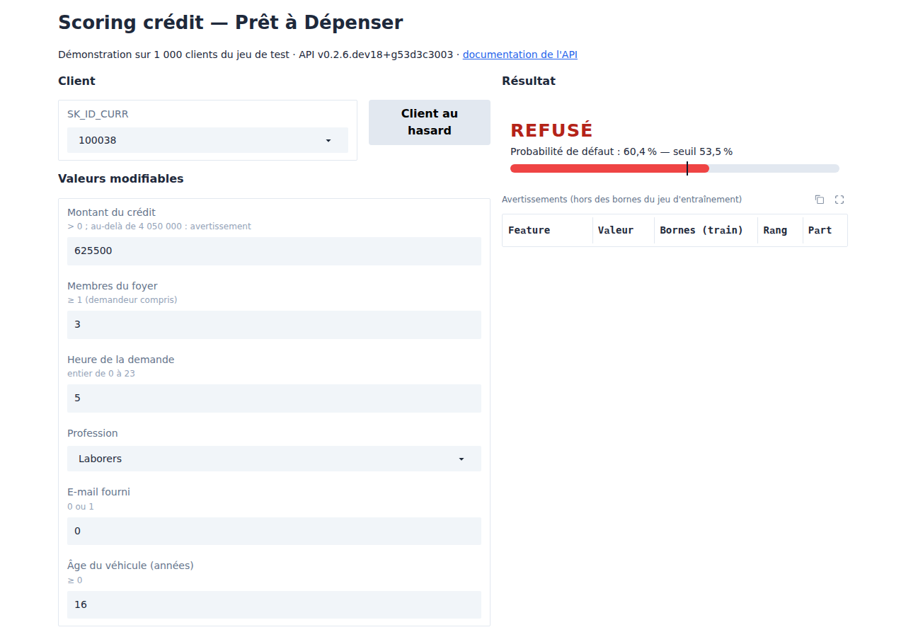
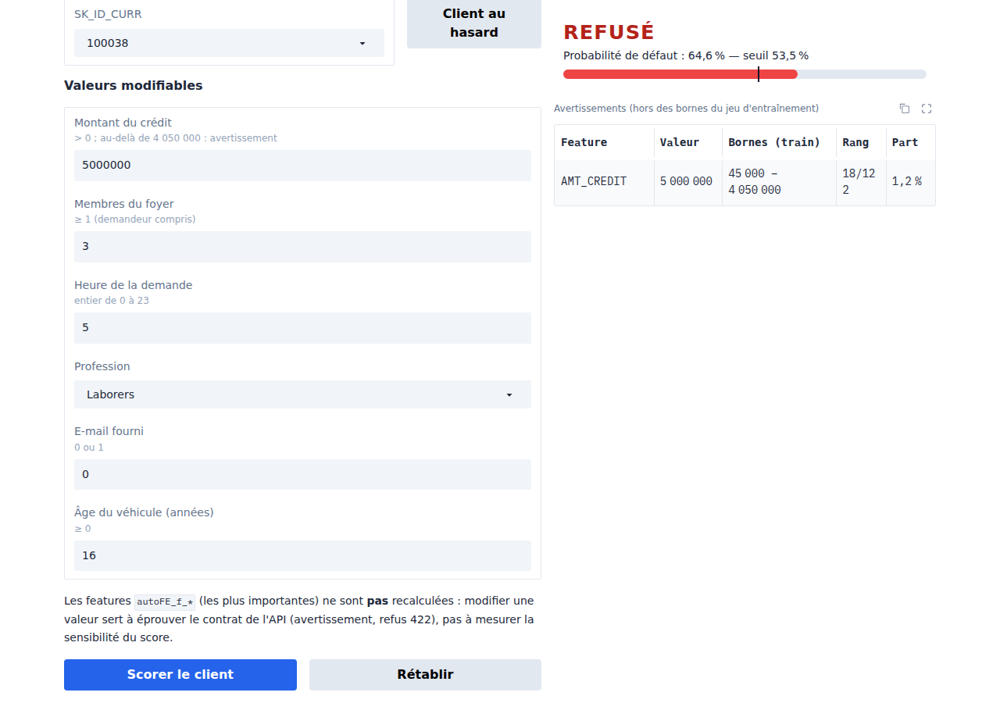
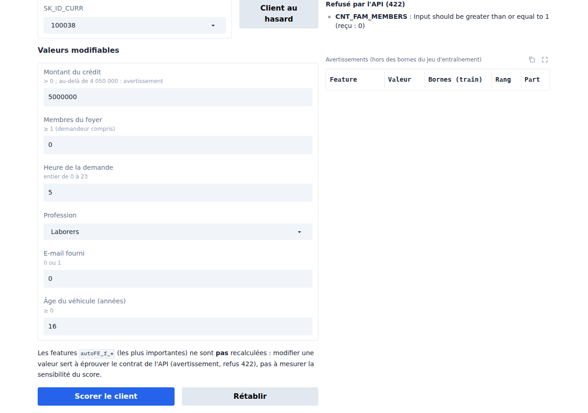
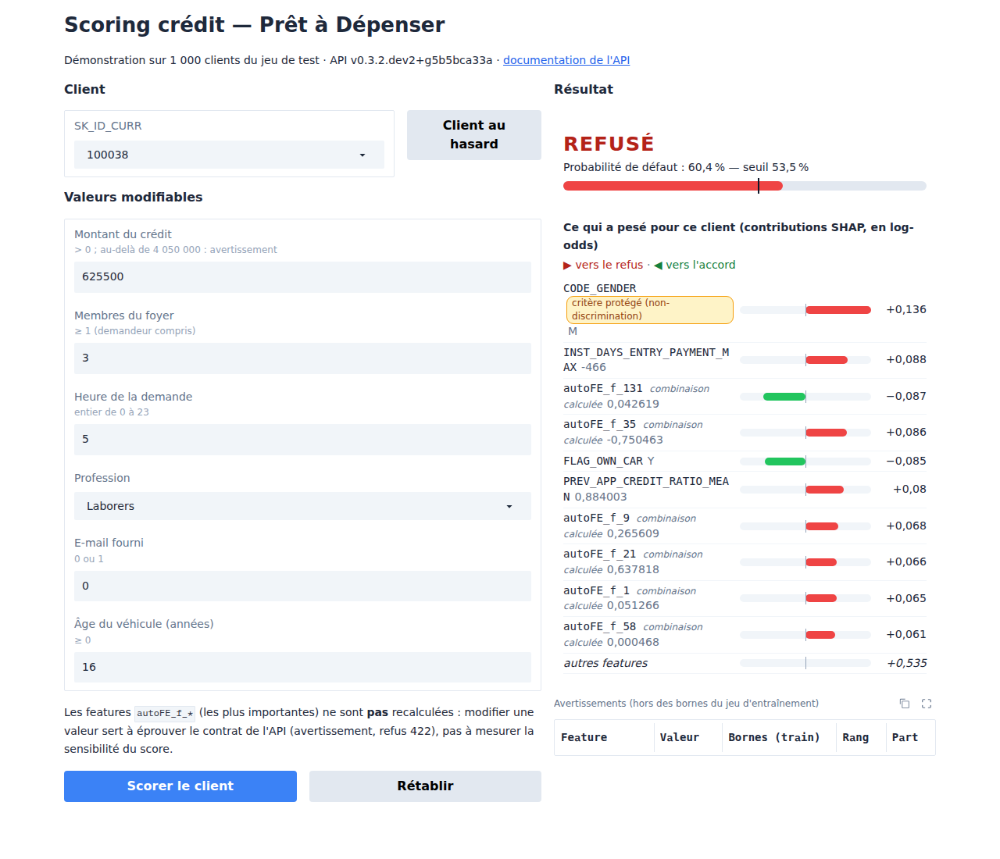
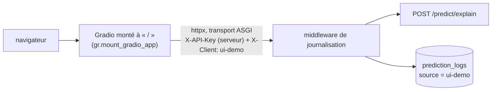

# Interface de démonstration (Gradio)

Racine du Space : **https://willisback-credit-scoring-api.hf.space/** (#40). Design :
`docs/superpowers/specs/2026-11-22-interface-gradio-design.md`.

## Parcours

1. **Choisir un client** parmi les 1 000 clients de démo (jeu de test Kaggle) : liste avec
   recherche, ou « Client au hasard ». Le score s'affiche aussitôt.
2. **Lire le résultat** : décision colorée, probabilité de défaut, barre avec le repère du
   seuil métier (53,5 %), et tableau des avertissements (valeur hors des bornes du jeu
   d'entraînement, rang et part d'importance de la feature).
3. **Comprendre le score** grâce au graphique « Ce qui a pesé pour ce client » (#44) :
   - il montre les 10 contributions SHAP les plus fortes, sur des barres centrées sur zéro
     (rouge : vers le refus ; vert : vers l'accord) ;
   - une ligne « autres features » regroupe le reste ;
   - un **badge « critère protégé (non-discrimination) »** signale `CODE_GENDER` ; son
     info-bulle donne la justification juridique ;
   - la mention **« combinaison calculée »** signale les features `autoFE_f_*` d'OpenFE.
     Elles forment 65 % du modèle (79 features sur 122) et n'ont pas de sens métier direct.
4. **Éprouver le contrat de l'API** en modifiant une valeur lisible (montant du crédit,
   taille du foyer, heure de la demande, profession, e-mail, âge du véhicule), puis
   « Scorer le client » ; « Rétablir » recharge les valeurs d'origine.

| Sélection | Avertissement (crédit à 5 000 000) | Refus 422 (foyer de 0 personne) |
|---|---|---|
|  |  |  |



*Client 100038, refusé. Sa première contribution est `CODE_GENDER = M` (+0,136 en
log-odds) : le modèle de P6 utilise le sexe, ce qu'une soutenance doit assumer (ADR-007).*

L'interface ne bloque aucune saisie : c'est l'API qui refuse, et l'interface affiche son
erreur 422 en clair (champ, règle, valeur reçue).

**Limite affichée à l'écran** : les features `autoFE_f_*`, les plus importantes, sont des
combinaisons calculées en amont et ne sont pas recalculées quand on modifie une feature
brute. La modification sert à démontrer le contrat (avertissement, refus), pas à mesurer
la sensibilité du score.

## Architecture



- **Même chemin que la production** : chaque score passe par la vraie route `/predict/explain`
  (validation, journalisation, avertissements, explication), sans réseau. Le client de démo
  est envoyé en entier : les journaux de l'interface ne portent donc pas de `client_ref`.
- **Clé côté serveur** : Space de démonstration (décision de William) ; la clé n'atteint
  jamais le navigateur. Les appels directs à `/predict` (curl, Swagger) l'exigent toujours.
- **Trafic distingué** : `source = ui-demo` dans les journaux ; les analyses de
  production filtrent `source = 'api'` (`docs/monitoring.md`).
- **Endpoints Gradio non documentés** : événements en `api_visibility="private"` (ni page
  « Use via API », ni clients Gradio), historique des entrées désactivé. En Gradio 6.32,
  « private » masque ces endpoints sans les désactiver : un appel direct à `/gradio_api/…`
  n'a que le pouvoir de l'interface (clients de démo, six champs validés par l'API). C'est
  assumé : la démonstration est publique (D4) ; la clé, elle, ne quitte jamais le serveur.
  Le serveur MCP de Gradio n'est pas activé.

## Lancer en local

```bash
uv sync                      # Gradio est dans le groupe dev et l'extra « ui »
MODEL_DIR=artifacts API_KEY=dev uv run uvicorn credit_scoring.api.app:app
# → http://127.0.0.1:8000/ (interface) et /docs (API)
```

L'image Docker n'installe pas l'extra `ui` : elle sert la page HTML de l'API à la racine.
